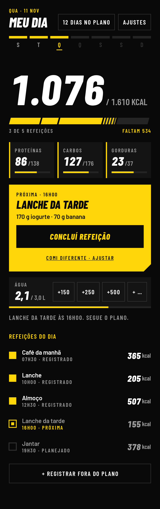
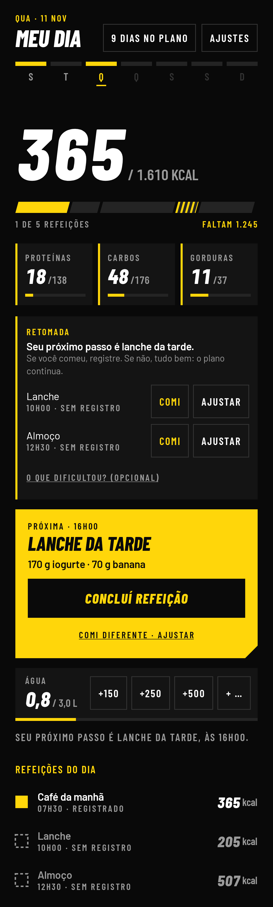
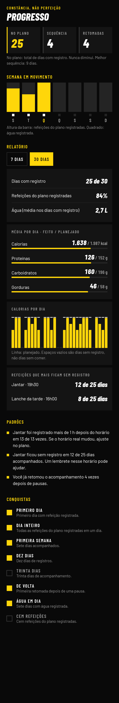

# No Plano

Aplicativo Android nativo para **executar** uma dieta já definida: o plano fica visível,
a próxima ação é óbvia e registrar uma refeição leva um toque.

Não é um contador de calorias tradicional. Você cadastra seu plano uma vez; depois,
cada dia é tocar em **CONCLUÍ REFEIÇÃO**.

<p>



</p>

## O que o app faz

- **Meu dia:** calorias, macros, água, próxima refeição e progresso em uma tela.
- **Registro em um toque**, com desfazer, consumo parcial, alternativas e "fora do plano".
- **Widget** na tela inicial (compacto e com botões), que registra sem abrir o app.
- **Lembretes** por regras locais: antes da refeição, refeição sem registro, água e resumo.
  Refeição já registrada não gera lembrete.
- **Retomada:** quando algo fica sem registro, o app aponta o próximo passo, sem culpa.
- **Progresso:** dias no plano (nunca zera), semana em movimento, conquistas, relatórios e padrões.
- **Backup** em arquivo, para trocar de celular sem perder nada.
- **Tabela TACO** (NEPA/UNICAMP) embutida, mais alimentos próprios cadastrados pelo rótulo.

Tudo fica no aparelho. O app não pede acesso à internet, não tem conta nem anúncios.

## Instalar no celular

1. Baixe o arquivo `no-plano.apk` (em **Releases**, no GitHub).
2. Abra o arquivo no celular. O Android vai pedir para permitir a instalação "de fonte
   desconhecida" para o app que abriu o arquivo (Chrome, Arquivos ou Drive). Permita.
3. Abra o **No Plano** e aceite as notificações.
4. Para o widget: segure um espaço vazio da tela inicial, toque em **Widgets** e escolha **No Plano**.

Antes de reinstalar ou trocar de aparelho: **Ajustes → Salvar backup**.

## Documentos

| Documento | Conteúdo |
|---|---|
| [docs/01-ESTRATEGIA.md](docs/01-ESTRATEGIA.md) | Análise do conceito, obstáculos de adesão, escopo, arquitetura |
| [docs/02-DESIGN.md](docs/02-DESIGN.md) | As três direções visuais, a escolha e o design system |
| [docs/03-ARQUITETURA.md](docs/03-ARQUITETURA.md) | Como o código está organizado |
| [docs/04-CHECKLIST-APARELHO.md](docs/04-CHECKLIST-APARELHO.md) | O que conferir no celular de verdade |

## Para desenvolver

Precisa de JDK 17 ou mais novo e do Android SDK (plataforma 35).

```bash
./gradlew :app:testDebugUnitTest
```

```bash
./gradlew :app:assembleRelease
```

As imagens de `docs/telas` são geradas a partir das telas reais:

```bash
./gradlew :app:recordRoborazziDebug
```

## Limites

O app acompanha um plano cadastrado por você. Ele não prescreve dietas e não substitui
nutricionista. Os valores da TACO são médias; produtos de marca devem ser cadastrados
pelo rótulo.
