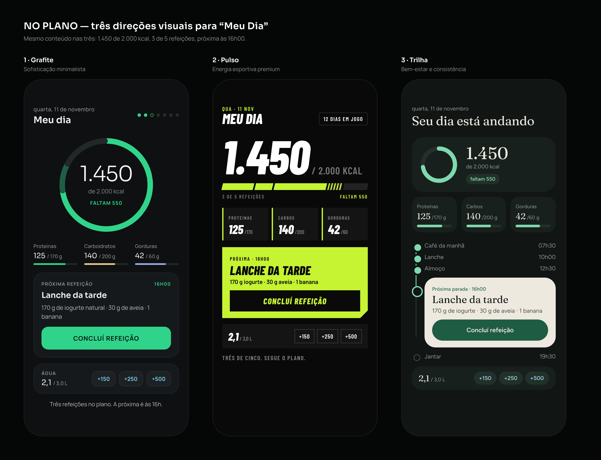
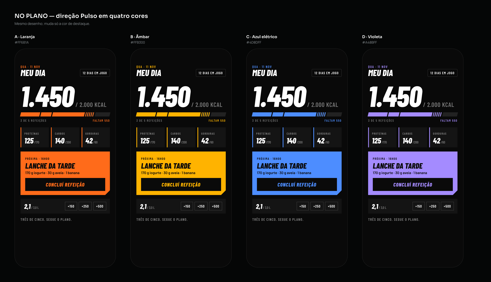
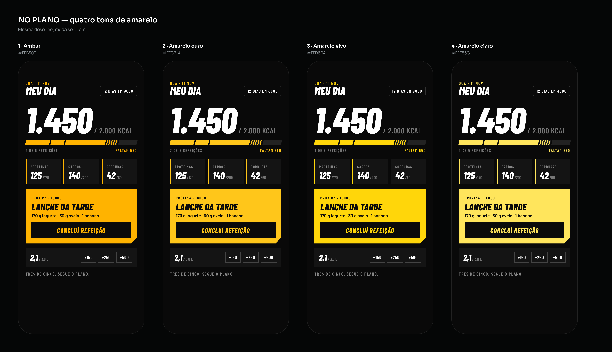
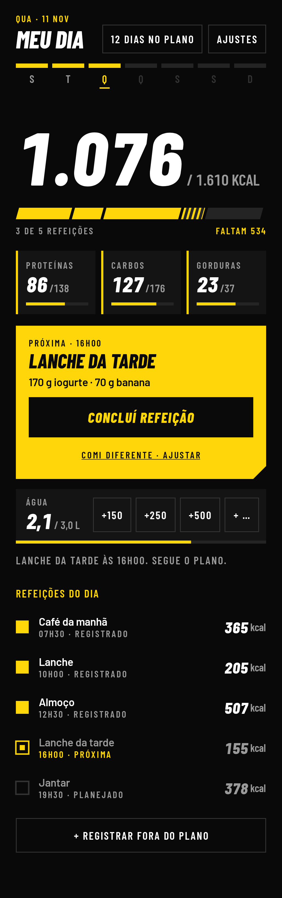
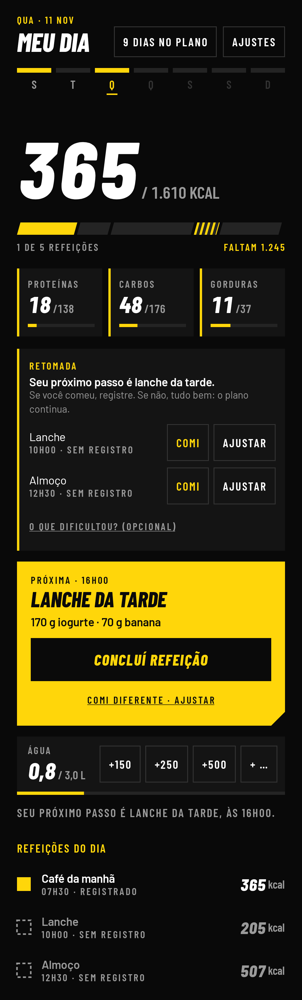
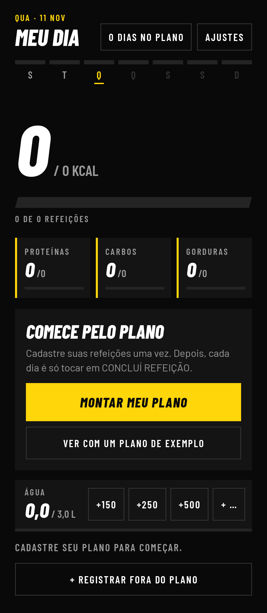
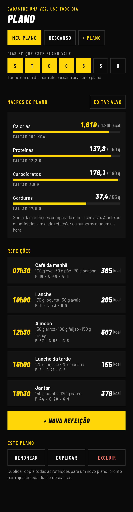
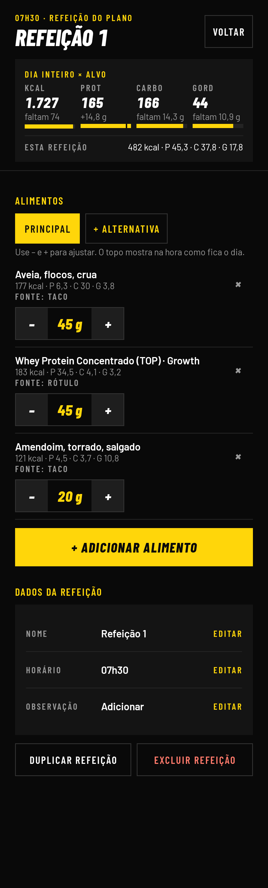
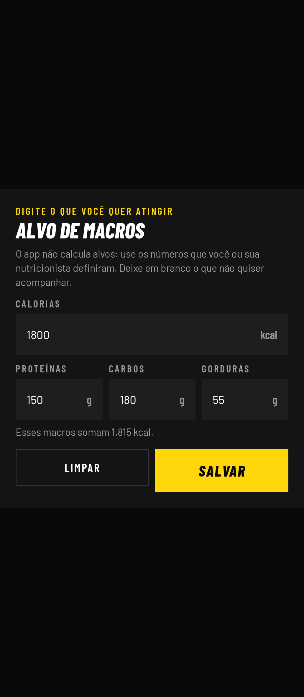
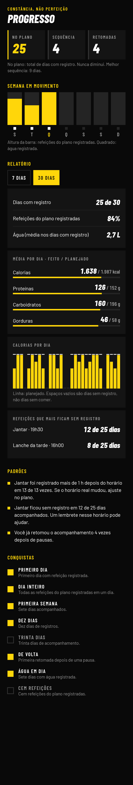

# NO PLANO — Design (Etapa 2)

## As três direções

| | 1 · Grafite | 2 · Pulso | 3 · Trilha |
|---|---|---|---|
| Ideia | Sofisticação minimalista | Energia esportiva premium | Bem-estar e consistência |
| Fundo | Grafite neutro `#0E1011` | Preto `#090909` | Grafite esverdeado `#111514` |
| Cor de progresso | Esmeralda `#2FD48A` | Lima `#C6F432` | Esmeralda suave `#7FD9AE` + creme |
| Tipografia | Sora (números leves) + Manrope | Barlow Condensed itálico pesado | Fraunces (serifada) + Figtree |
| Elemento-assinatura | Anel do Plano, segmentado por refeição | Número gigante e barra em faixas | Trilha vertical do dia |

## Avaliação

Notas de 1 a 5. São julgamentos de design **[Hipótese]**, não medições.

| Critério | Grafite | Pulso | Trilha |
|---|---|---|---|
| Clareza (responder as 6 perguntas em segundos) | 5 | 4 | 4 |
| Apelo emocional | 4 | 5 | 4 |
| Acessibilidade (contraste, tamanho, leitura) | 5 | 3 | 4 |
| Facilidade de uso com uma mão | 5 | 4 | 3 |
| Motivação sustentável (meses e anos) | 5 | 3 | 5 |
| **Total** | **24** | **19** | **20** |

- **Pulso** empolga no primeiro dia, mas grita. Texto condensado em caixa alta cansa, o
  cartão lima ocupa a tela inteira de atenção e o tom "em jogo" puxa para desempenho,
  que é o oposto de tranquilidade num dia ruim.
- **Trilha** tem a melhor metáfora de continuidade, mas a trilha vertical empurra a água
  para fora da primeira dobra e o botão principal muda de posição conforme o dia avança.
- **Grafite** responde tudo sem rolar, mantém o botão sempre no mesmo lugar e usa a cor
  só onde há progresso. É a que menos envelhece.

## Direção escolhida: Pulso, em amarelo vivo

A avaliação acima apontava Grafite. **O dono do app escolheu a Pulso**, trocando o verde
por amarelo, e essa é a direção implementada. É uma decisão de gosto legítima: o app
precisa dar vontade de abrir. Para compensar os pontos fracos apontados na tabela, a
implementação fez três ajustes:

- **Leitura:** a fonte condensada em caixa alta fica só em números, títulos e rótulos
  curtos. Todo texto corrido usa Barlow normal, em caixa mista, com 15 sp.
- **Tom:** nada de "em jogo" ou linguagem de desempenho. O contador diz "dias no plano"
  e nunca zera; as mensagens continuam calmas.
- **Atenção:** o cartão amarelo cheio existe uma vez por tela, sempre na próxima ação.

## Telas implementadas

Geradas a partir do código real do app.

| Meu dia | Retomada | Primeiro uso |
|---|---|---|
|  |  |  |

| Plano | Editar refeição | Alvo de macros |
|---|---|---|
|  |  |  |

| Progresso |
|---|
|  |

## Design system

### Cores

| Papel | Token | Valor | Uso |
|---|---|---|---|
| Fundo | `fundo` | `#090909` | Tela |
| Superfície | `superficie` | `#141414` | Cartões |
| Superfície elevada | `superficieAlta` | `#1E1E1E` | Campos |
| Linha | `linha` | `#333333` | Contornos de 1 dp |
| Trilho | `trilho` | `#242424` | Parte vazia das barras |
| Texto | `texto` | `#FFFFFF` | Principal (contraste 20:1 sobre o fundo) |
| Texto secundário | `textoSuave` | `#9A9A9A` | Rótulos (contraste 7:1) |
| Destaque | `destaque` | `#FFD60A` | Progresso, próxima ação, concluído (contraste 14:1 sobre o fundo) |
| Sobre o destaque | `sobreDestaque` | `#0A0A0A` | Texto sobre amarelo (contraste 14:1) |
| Erro | `erro` | `#FF7A6B` | Ações de excluir e falhas |

Uma única cor de destaque. Os três macros usam a mesma cor e se distinguem pelo rótulo.
Não existe cor de "passou da meta".

### Tipografia

- **Barlow Condensed ExtraBold Itálico** para números e títulos.
- **Barlow Condensed SemiBold**, em caixa alta e espaçada, para rótulos.
- **Barlow** para texto.
- Números sempre tabulares, para não "dançar" durante a contagem.

| Estilo | Tamanho |
|---|---|
| Número herói (calorias) | 104 sp |
| Número grande | 40 sp |
| Título de tela | 34 sp |
| Número de cartão | 30 sp |
| Título de cartão | 28 sp |
| Botão | 20 sp |
| Corpo | 15 sp |
| Rótulo | 13 sp |

O app respeita o tamanho de fonte do sistema.

### Forma e espaço

- Formas retas, sem cantos arredondados. O cartão da próxima refeição tem um canto cortado.
- **Barra do dia:** um segmento inclinado por refeição, com largura proporcional às
  calorias. Feito = cheio; próxima = hachurado; restante = vazio.
- Margem lateral de 22 dp. Alvos de toque de no mínimo 48 dp; botão principal com 56 dp.

### Movimento

- Barras e números animam até o novo valor em 600 ms, desacelerando.
- O botão principal encolhe 3% ao toque.
- Nada pisca nem se repete em laço.

### Tato

Vibração curta ao concluir refeição e ao adicionar água. Pode ser desligada nos Ajustes.

### Voz

Frases curtas, no presente, sobre o dia. Sem culpa e sem "você falhou". Exemplos:
"Lanche da tarde às 16h00. Segue o plano." / "Seu próximo passo é o jantar."
